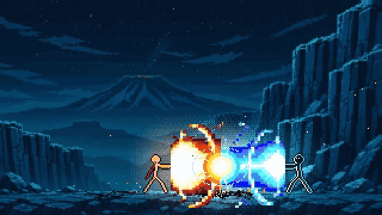
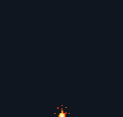
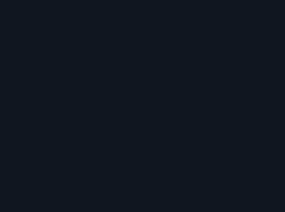
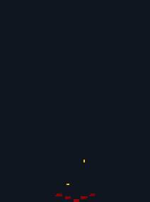
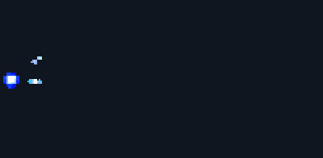
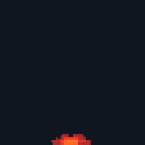

# ChatGPT GIF to game-ready pixel art effects

One ChatGPT prompt makes the animation; a script turns it into a real sprite sheet, an image AI lights the background, and a small Godot 4 scene adds the flash, the shake, the debris and the smoke.

<p align="center"></p>

The big effects in this fight are ChatGPT GIFs, one prompt each: the energy beams (one GIF, mirrored and recoloured for the second beam), the lightning, the explosion and the volcano eruption. Everything else (the stick figures, camera, light, background motion and small extras such as rocks, sparks and cracks) is code in a fight scene that is not part of this repository. The prompts, the cleanup script, the cleaned sprite sheets and a Godot scene for the explosion are.

## Contents

- [Quickstart](#quickstart)
- [The guide: four steps, seven problems](#the-guide-four-steps-seven-problems)
- [Gallery](#gallery)
- [Other videos](#other-videos)
- [What's in this repository](#whats-in-this-repository)
- [Notes](#notes)
- [License](#license)

## Quickstart

You need Python 3.10 or newer (tested with 3.13 on Windows 11) and Godot 4.7 (tested with 4.7.2, the standard build). ffmpeg is optional: if it is on your PATH, the cleanup also writes a review mp4.

Get the files with **Code → Download ZIP** on this page (unzip it), or with git:

```text
git clone https://github.com/kasperzackgames/chatgpt-pixel-effects.git
cd chatgpt-pixel-effects
```

Run every command from the repository folder (the one with this README). They work the same in PowerShell, Git Bash and macOS or Linux terminals (on Windows use PowerShell, not cmd).

**1. Install the Python packages once.**

```text
python -m venv .venv
```

Activate it, then install the packages:

| Shell | Activate |
|---|---|
| PowerShell | `.venv\Scripts\Activate.ps1` (if it says running scripts is disabled, first run `Set-ExecutionPolicy -Scope Process -ExecutionPolicy Bypass`) |
| Git Bash | `source .venv/Scripts/activate` |
| macOS, Linux | `source .venv/bin/activate` |

```text
python -m pip install -r requirements.txt
```

That installs numpy, Pillow, scipy, scikit-learn and unfake 1.0.7 (content-adaptive downscale, MIT) with its opencv-python, at the versions I tested. On Windows, if `python` is not found, use `py -3` in the first line.

**2. Clean the example GIF into a sprite sheet** (a few seconds):

```text
python scripts/clean_gif.py example/explosion.gif --name explosion --mode adaptive --cell 2.6 --impact 1 --scale 1 --neutral-greys --grey-chroma 0.05 --colors 20 --out-dir out
```

The sheet lands in `out/explosion/explosion_sheet.png`, pixel-identical to `example/explosion_sheet.png`.

**3. Play it in Godot.** Open Godot 4.7, click Import in the project manager, choose `godot/project.godot`, then press F5 (Run Project). Space or a click sets off a blast.

The guide below explains every step, every setting and how to use your own GIF and background.

## The guide: four steps, seven problems

> **The honest part.** ChatGPT draws HD pixel art; the cleanup resizes it. Its pixels are not on one exact grid (2.5 to 4 image pixels wide in my example) and a single frame has up to 253 colours. The cleanup script brings every frame to one fixed grid of 122 x 116 art pixels and one shared palette of 26 colours, and pins the blast to the ground. The drawing is ChatGPT's; the script makes it usable in a game.

The guide follows the explosion in `example/`. The four other effects went through the same steps; their prompts and exact commands are in [`effects/`](effects/). Problems 1 to 4 are fixed in the prompt, problems 5 to 7 after it.

### Step 1: Ask ChatGPT for the GIF

Paste this prompt into ChatGPT as one message (you need a ChatGPT that can make animated GIFs) and save the GIF it returns, for example as `my_explosion.gif` in the repository folder. Or follow along with `example/explosion.gif`. The GIFs in this repository came from ChatGPT (Images 2.6). The prompt is also in [`PROMPT.md`](PROMPT.md).

```text
Make an animated GIF of a pixel-art explosion for a 2D side-view game, rendered as large as you can (at least 512x512). 16 frames, about 80 ms per frame. Use fine pixel art: each art pixel is only 2 to 3 image pixels wide, so the explosion has a lot of detail (about 120 art pixels tall at its peak). The camera does not move. The bottom edge of the frame is the ground line, and the explosion hits the ground at the bottom centre, at the same point in every frame. Don't draw the ground itself. Sequence: a tiny spark on the ground; one bright white flash frame; a huge orange and yellow fireball that grows until it fills about three quarters of the frame height and rises into a mushroom cloud with a fiery stem; debris chunks and sparks flying out in arcs; a thin dust ring rolling sideways along the ground; the fire breaks up into a light grey smoke column that rises and drifts; glowing embers fade out until the frame is empty. True pixel art: crisp pixels on one even grid, hard edges, no anti-aliasing, no blur, no soft gradients, a limited palette of about 20 colours (white, yellows, oranges, reds, dark reds and four neutral greys for the smoke). Background: flat solid pure magenta #FF00FF in every frame, nothing else. No text, no borders.
```

- ChatGPT ignores the size request. Expect about 300 x 300 pixels; mine came back at 316 x 301, 16 frames, 80 ms each.
- Results vary. Re-roll when the explosion is small, cut off at an edge, or drawn with big, coarse pixels.

The first four problems are fixed by sentences in the prompts:

#### Problem 1: the GIF wobbles and won't line up in a game

Fix: pin it to one point in the prompt: "The bottom edge of the frame is the ground line, and the explosion hits the ground at the bottom centre, at the same point in every frame." For a beam, pin its origin instead: "The beam starts at the left edge at mid-height, at the same point in every frame." For effects that touch the ground, the cleanup in step 2 removes the wobble that is left.

#### Problem 2: chunky pixels

Fix: "Use fine pixel art: each art pixel is only 2 to 3 image pixels wide." If it still comes back coarse, re-roll.

#### Problem 3: you can't cut it out

Fix: "flat solid pure magenta #FF00FF in every frame". Keep the magenta background: the script removes it. For violet or purple effects like lightning, ask for pure green `#00FF00` instead and add `--key green` in step 2, or the key eats the violet.

#### Problem 4: flames cut off at the top of the frame

Fix: "The tallest flame tips reach about 85 percent of the frame height: always leave empty background above the fire and at both sides, so nothing is ever cut off by the frame edges." My first fire pillar asked for flames that reach the top of the frame, and they came back cut flat. The re-roll with this sentence and a tall frame is in [`effects/fire-pillar/`](effects/fire-pillar/).

### Step 2: Clean it into a sprite sheet

#### Problem 5: it isn't real pixel art

Up to 253 colours in one frame, soft edges, no shared grid. Fix: a cleanup script that keys out the background, puts every frame on one pixel grid, gives all frames one palette (26 colours for the explosion), pins the blast to the ground (mean frame-to-frame wobble 0.43 to 0.30 px) and writes a sprite sheet with JSON. With the packages from the [Quickstart](#quickstart) installed:

```text
python scripts/clean_gif.py example/explosion.gif --name explosion --mode adaptive --cell 2.6 --impact 1 --scale 1 --neutral-greys --grey-chroma 0.05 --colors 20 --out-dir out
```

Swap in your own GIF and name. In a few seconds the script splits the GIF, removes the magenta (with edge despill), brings every frame to one fixed pixel grid, maps all frames to one palette, pulls the magenta tint out of the smoke greys, anchors the blast at the bottom centre (the ground), removes frame-to-frame wobble, cleans key-colour fringe and exports.

It prints two lines: a summary and a per-frame list. Without ffmpeg it also prints a note that the review mp4 was skipped. **Expected for the example** (the summary line):

```text
{"name": "explosion", "cell_px": 2.6, "grid_score": null, "native": [122, 116], "colors_after_snap": 48, "colors_final": 26, "greys_detinted": ["#ab918e", "#5c4343", "#876c6c", "#4c3030", "#b09e9c", "#685253", "#938081", "#2d1b1c", "#e1d0c5", "#1e1011"], "biggest_frame": 8, "jitter_before": {"mean_x_step_px": 0.43, "max_x_step_px": 1.14, "max_abs_x_off_px": 2.14, "max_abs_base_off_px": 25.0}, "jitter_after": {"mean_x_step_px": 0.3, "max_x_step_px": 1.05, "max_abs_x_off_px": 2.14, "max_abs_base_off_px": 25.0}, "fringe_pixels_fixed": 102}
```

and `out/explosion/explosion_sheet.png` is pixel-identical to `example/explosion_sheet.png`.

Outputs in `out/explosion/`:

| File | What |
|---|---|
| `explosion_sheet.png` | the sprite sheet: 16 frames of 122x116 in one row |
| `explosion_sheet.json` | Aseprite-style frame rects, 80 ms per frame, `meta.anchor` (61, 115) = the pixel where the blast touches the ground, frame tags anticipation / impact / fireball / smoke, the palette |
| `explosion_contact.png` | all frames numbered on a dark backdrop: check the flash frame, the peak and the smoke |
| `explosion_x6.gif`, `explosion_x6.mp4` | review animation at x6 (the mp4 only with ffmpeg) |
| `explosion_palette.hex`, `explosion_metrics.json`, `frames/` | palette, every measured number, single frames |

The settings worth knowing, chosen by looking at the contact sheet:

- `--mode adaptive` when the GIF has no clean pixel grid (most ChatGPT GIFs); `--mode snap --cell 0` (detect the grid) when its blocks are clearly all the same size.
- `--cell` (adaptive): the GIF's height divided by the sprite height you want in game pixels. 301 / 116 = 2.6 gives a peak of about 119x114 in the 320x180 scene. Below about 1.7 the downscale stops working.
- `--impact`: the number of the white flash frame (here 1). The scene flashes, shakes and starts its debris on it.
- `--neutral-greys --grey-chroma 0.05`: only if the smoke looks tinted; 0.05 removes a slight pink tint and keeps warm brown smoke near the fire, 0.09 also catches strong purple tints.
- `--scale`: 1 here; 2 only for a coarse GIF whose peak would be too small.
- `--key green` for a green background; `--anchor left` for effects that start at the left edge (beams).
- `python scripts/clean_gif.py --help` lists every option.

### Step 3: Light the background

#### Problem 6: the effect looks pasted on

Fix: ask an image AI to repaint the background lit by a fire at the blast point, keep only the pixels that got warmer, and blend that copy in near the blast while it burns. Instead of a glow drawn on top, the scene blends the background toward a lit copy of itself (warm light on the floor and the rock faces near the blast, sky left alone), cleaned so that every pixel the fire does not light is identical to the background. This takes about 2 minutes.

a) First mark where the blast hits. This makes the background five times bigger, with an orange spot where the blast touches the ground (game pixels; for the canyon 5 px above the ground point 196, 159):

```text
python scripts/make_marked_input.py godot/backgrounds/canyon.png 196 154 out/lit/marked_x5.png
```

b) Relight it: open an image AI that edits an attached picture, attach `out/lit/marked_x5.png` and send this prompt (also in [`RELIGHT-PROMPT.md`](RELIGHT-PROMPT.md)). Any such image model works; I used OpenAI's image model (the one ChatGPT uses) through the Codex CLI.

```text
a relit copy of the attached pixel-art game background: exactly the same picture, same composition, same framing, same size and the same pixel grid, every shape, edge, rock and star in exactly the same place. Change only the lighting: a huge explosion is burning on the canyon floor at the orange spot (do not draw the explosion or the spot; at the spot there is just brightly lit ground). Its warm orange and yellow light falls on the canyon floor around the spot and on the cliff faces and rocks that face it, strongest close to the spot and falling off quickly with distance; rock faces turned toward the fire get warm orange highlights, faces turned away keep their cold blue shading. The night sky, the stars, the distant volcano, the far mountains and the mist far from the fire stay dark and blue, unchanged. True pixel art, crisp pixels on the same grid, no blur, no glow haze over the sky, no text.
```

Save the result as `out/lit/relit_1.png` (and a second try as `relit_2.png` if you can). It must show the same framing as the input; any size is fine.

c) Keep only the real light, and compare the versions side by side:

```text
python scripts/make_lit.py godot/backgrounds/canyon.png out/lit/relit_1.png out/lit/lit_1.png
python scripts/compare_lit.py godot/backgrounds/canyon.png out/lit/lit_1.png --out out/lit/pick.png
```

(With two versions, run `make_lit.py` for `relit_2.png` too and add `out/lit/lit_2.png` to the `compare_lit.py` line.) The repository includes my relit picture, so you can try this step without an image AI:

```text
python scripts/make_lit.py godot/backgrounds/canyon.png example/canyon_relit.png out/lit/lit_example.png
```

**Expected for the example:**

```text
{'out': 'out/lit/lit_example.png', 'raw_size': [1672, 941], 'mode': 'painting', 'lit_pixels_pct': 10.9, 'best_shift': [0, 0], 'mean_diff_outside_lit': 0.0221, 'darker_rejected_px': 319, 'smear_rejected_px': 770, 'specks_dropped_px': 95, 'lit_mean_dL': 0.205, 'dull_lit_px': 25, 'dull_box': [86, 80, 298, 171], 'identical_to_bg_pct': 89.1}
```

`make_lit.py` keeps a relit pixel only where the picture made the surface warmer (`--gain 0.02`), not darker (`--max-darken 0.02`: light never darkens; this rejects grey-brown smears in the mist), and not "barely brighter and nearly grey" (`--smear-dl 0.03 --smear-chroma 0.06`: haze). It drops warm groups smaller than `--min-group 6` pixels (stars the AI tinted yellow). Everywhere else it copies the background pixel, so the sky can never change. Check:

- `best_shift` must be `[0, 0]` (the copy lines up pixel for pixel) and `mean_diff_outside_lit` small (0.015 to 0.027 in my tests).
- `lit_pixels_pct` about 8 to 13 for this canyon, `identical_to_bg_pct` about 87 to 92.
- `darker_rejected_px` and `smear_rejected_px` show how much the flaw rules threw out (about 300 to 3,000 each in my tests); `dull_lit_px` (greyed pixels left in the lit part) should be small.
- In `out/lit/pick.png` (top: whole picture x2; bottom: floor, cliffs and mist x4) the sky and mist must look exactly like the background, with no grey or brown haze. If not, relight again.

d) Put the one you pick into the scene:

```text
cp out/lit/lit_1.png godot/backgrounds/canyon_lit.png
```

The shipped `godot/backgrounds/canyon_lit.png` comes from the same relit picture as `example/canyon_relit.png`, cleaned by an earlier version of `make_lit.py` that only had the "warmer" rule, so 12.8% of its pixels are lit instead of 10.9%. Both look right in the scene.

Fallback when no version lines up (`best_shift` not `[0, 0]`) or the light lands on the sky: draw a mask in any pixel editor, the size of the background, white over the floor and the rock faces the blast can light, black everywhere else. Then keep the relit picture only inside the mask, or skip the picture entirely (a warm tint, `--strength 0.55`; the scene's radial mask still fades it with distance):

```text
python scripts/make_lit.py godot/backgrounds/canyon.png out/lit/relit_1.png out/lit/lit_1.png --mask out/lit/mask.png
python scripts/make_lit.py godot/backgrounds/canyon.png - out/lit/lit_1.png --synthetic --mask out/lit/mask.png
```

For your own background, describe its parts in the relight prompt instead of "canyon floor", "cliff faces", "volcano" and "far mountains", and keep the rule that the sky stays unchanged. In the fight at the top, the fire pillar, the explosion and the dying glow use this painted light; the lightning and the cyan beam get a coded colour light with an ordered dither instead (that light is part of the fight scene, not of this repository).

### Step 4: Play it in Godot

#### Problem 7: it doesn't feel like a hit

Fix, in Godot: a flash, screen shake in whole pixels, a few rocks, a scorch mark, embers, and the smoke held for 1.8 s so it drifts away instead of popping. The fight at the top also uses a 4 to 6 frame hit-stop (everything freezes for 4 to 6 frames at 60 fps) and 2 black-and-white impact frames at the lightning hit and at the slam; those two are in the fight scene, not in the Godot scene here.

Open `godot/project.godot` in Godot 4.7 (Import in the project manager) and press F5. Or from a terminal, where `godot` stands for your Godot executable (on Windows the `..._console.exe` shows the printed lines; in PowerShell put `&` in front of a quoted path):

```text
godot --path godot
```

A 1280x720 window opens (the game renders at 320x180 and scales x4) and prints, among others:

```text
light: painted light from res://backgrounds/canyon_lit.png
explosion: sheet res://sprites/explosion_sheet.png  frames 13  ground (196, 159)  flash 0.4  loop period 0.0
```

The explosion repeats on its own. Keys: Space, Enter or click = explode now, L = auto loop on/off, F = flash 100% / 40% / off.

What the scene does (`main.gd`, `blast.gd`, `shaders/`):

- Plays the sheet at its JSON durations (80 ms a frame) with the sprite origin on the JSON's anchor, so the blast sits on the ground point.
- Measures each frame's fire brightness to drive the light; flashes 40% and shakes the camera in whole pixels on the frame tagged `impact`.
- Draws rocks on gravity arcs with one bounce, a scorch mark and embers in whole pixels, in colours picked from the sheet's palette. Everything is seeded, so a blast always looks the same.
- Holds the fullest smoke frame 1.8 s, lets it rise and drift, and erodes it in clean clumps from the ground up (`shaders/dissolve.gdshader`).
- Blends the background toward the lit copy by the fire's brightness under a soft radial mask, in 4 whole-pixel steps with a fixed 4x4 Bayer pattern between them (`shaders/light_painted.gdshader`). Where the two pictures are identical (sky, stars, far mist) nothing changes, so no band or seam can show.
- `project.godot`: 320x180 viewport, 1280x720 window, viewport stretch with integer scaling, nearest filter, 2D pixel snapping, Compatibility renderer. Every pixel stays square.

Your own files: copy your sheet and its JSON into `godot/sprites/` and your lit background into `godot/backgrounds/`, then pass them after a `--` (or overwrite `explosion_sheet.png`/`.json` and `canyon_lit.png`):

```text
godot --path godot -- --sheet=res://sprites/my_sheet.png --lit=res://backgrounds/my_lit.png
```

| Option (after `--`) | Default | Meaning |
|---|---|---|
| `--sheet=PATH.png` (`--json=PATH.json`) | `res://sprites/explosion_sheet.png` (the JSON next to it) | the sprite sheet from step 2 |
| `--bg=PATH.png` | `res://backgrounds/canyon.png` | the background, 320x180 |
| `--lit=PATH.png` | `res://backgrounds/canyon_lit.png` | the lit copy from step 3; `none` = a simple shader light (it also lights the sky) |
| `--x=196 --ground=159` | 196, 159 | where the blast touches the ground, in game pixels |
| `--flash=0.4` | 0.4 | full-screen flash strength on the impact frame, 0 = off |
| `--shake=1` | 1 | whole-pixel screen shake strength, 0 = off |
| `--hold-from=12` | 12 | this frame (the fullest smoke column) is held 1.8 s, rises, drifts right and erodes from the ground up; later frames are not played |
| `--layers=rocks,scorch,embers` | rocks,scorch,embers | coded extras: rocks fly out and land, a scorch mark stays, embers linger; also `sparks`, `streak`, `dust`, `spark` (the GIF has its own versions of these); `--layers=` = none |
| `--light-y=15` | 15 | centre of the light mask, this many px above the ground |
| `--volcano=1` | 1 | faint glow on the canyon's volcano top at (122, 62); 0 for any other background |
| `--first=0.4` | 0.4 | seconds before the first blast |
| `--interval=2.6` | 2.6 | seconds between the end of one blast's sprite and the next blast |
| `--loop-period=1.0` | off | one blast every N s with the same seed: a seamless loop |

Paths can be `res://...` (inside `godot/`) or absolute.

Record a clip: 8 s = 480 frames of 320x180 as PNG in `godot/capture/` (the path is relative to `godot/`). It needs a window, not `--headless`, and Godot closes by itself when done. The `.gdignore` file in that folder keeps the editor from importing the frames.

```text
godot --path godot --write-movie capture/frame.png --fixed-fps 60 --quit-after 480
```

Using the sheet in your own game: it is one row of equal frames; the JSON has each frame's rect and duration, `meta.anchor` (put the sprite's origin there and place it on the ground), the frame tags (start flash and shake on `impact`) and the palette.

## Gallery

Five effects, one ChatGPT prompt each. Every folder has the prompt, the GIF as ChatGPT returned it, the cleaned 1x sprite sheet with its JSON, and the exact cleanup command. The previews show the cleaned frames at x2.

| Effect | Preview | Sheet |
|---|---|---|
| **Explosion**<br>[`example/`](example/), prompt in [`PROMPT.md`](PROMPT.md) |  | 16 frames of 122x116, 80 ms, 26 colours |
| **Lightning**<br>[`effects/lightning/`](effects/lightning/) |  | 14 frames of 208x155, 70 ms, 22 colours, green key |
| **Fire pillar**<br>[`effects/fire-pillar/`](effects/fire-pillar/) |  | 16 frames of 106x143, 80 ms, 26 colours |
| **Energy beam**<br>[`effects/beam/`](effects/beam/) |  | 16 frames of 200x98, 70 ms, 20 colours, anchored at the left edge |
| **Volcano eruption**<br>[`effects/eruption/`](effects/eruption/) |  | 16 frames of 91x91, 90 ms, 24 colours, for a distant background |

## Other videos

- How to Make Pixel Art Lightning with ChatGPT (Step by Step) (coming soon)
- How to Make Pixel Art Fire with ChatGPT (Step by Step) (coming soon)
- How to Make a Pixel Art Beam Clash with ChatGPT (Step by Step) (coming soon)

## What's in this repository

```text
README.md            this guide
PROMPT.md            the explosion prompt for ChatGPT (step 1)
RELIGHT-PROMPT.md    the relight prompt for an image AI (step 3)
requirements.txt     the Python packages, pinned to the tested versions
LICENSE              MIT
scripts/
  clean_gif.py         step 2: GIF -> sprite sheet + JSON
  make_marked_input.py step 3: background x5 with an orange spot where the blast is (the image AI's input)
  make_lit.py          step 3: relit picture -> lit background (only the real light kept)
  compare_lit.py       step 3: side-by-side picture to choose between lit versions
  pixelcore.py         shared image routines used by clean_gif.py and make_lit.py
example/
  explosion.gif        my ChatGPT GIF (316x301, 16 frames, 80 ms each)
  explosion_sheet.png  its cleaned sheet (16 frames of 122x116 in one row) and explosion_sheet.json
  canyon_relit.png     the relit canyon from the image AI (1672x941), input for make_lit.py
  preview.gif          the cleaned frames at x2 (the gallery preview)
effects/
  lightning/           one folder per effect: the ChatGPT GIF, the cleaned sheet and its JSON,
  fire-pillar/         preview.gif, and a README with the exact prompt and cleanup command
  beam/
  eruption/
godot/                 a standalone Godot 4.7 project (320x180, integer scaling, nearest filter)
  project.godot, main.tscn  the project and its one scene
  main.gd              loads the sheet and backgrounds, spawns blasts, flash, shake and light
  blast.gd             one blast: sheet frames, held smoke, coded rocks, scorch and embers
  shaders/             light_painted (blend toward the lit copy), light_simple (--lit=none), dissolve (smoke)
  sprites/             explosion_sheet.png + .json (the same as example/)
  backgrounds/         canyon.png (320x180) and canyon_lit.png
  capture/             empty; movie frames go here
media/
  fight.gif            the animation at the top of this page (a silent capture of the fight scene)
```

## Notes

### What ChatGPT does not do well

- It draws "HD pixel art": its pixels were 2.5 to 4 image pixels wide, not on one grid, and up to 253 colours in one frame. The lightning's grid is about 4 image pixels, although the prompt asked for 2 to 3.
- It ignores size requests. All seven GIFs came back with about 93,000 to 96,000 pixels, whatever the shape: 316 x 301 for the explosion (I asked for at least 512 x 512), 265 x 358 for the tall fire pillar, 439 x 216 for the wide beam.
- Results vary. 5 of my 7 GIFs were usable; one was too coarse and one was cut off at the top. A used one can still miss part of the prompt: the eruption's ash touches the top edge in its later frames, although the prompt asked for the top of the ash to stay inside the frame.

### Credits and AI

- The GIFs come from ChatGPT (Images 2.6), OpenAI's image model, one prompt each.
- The canyon background and the relit background were made with OpenAI's image model through the Codex CLI.
- The scripts and the Godot scene were written with an AI coding agent (I used Claude Code; Codex does the same job here).
- The narration in the videos is an AI voice.
- unfake, which the scripts install from PyPI, is MIT licensed by its own author.
- ChatGPT is a trademark of OpenAI, Godot a trademark of the Godot Foundation; this repository is not affiliated with either.

## License

MIT, see [`LICENSE`](LICENSE). The GIFs (made with ChatGPT), the backgrounds and the relit picture (made with OpenAI's image model through the Codex CLI) were AI-generated by me and are included under the same licence, as are the sprite sheets and previews made from them and the silent fight capture in `media/`.

Made by Kasperzack Games, https://kasperzackgames.de
