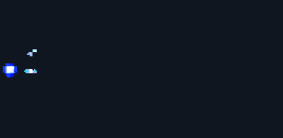

# Energy beam

<p align="center"></p>

A pixel art energy beam from one ChatGPT (Images 2.6) prompt, cleaned into a sprite sheet with [`scripts/clean_gif.py`](../../scripts/clean_gif.py). The [main README](../../README.md) explains every step; this page has what is specific to the beam.

Video: How to Make a Pixel Art Beam Clash with ChatGPT (Step by Step) (coming soon)

## Files

| File | What |
|---|---|
| `beam.gif` | the GIF as ChatGPT returned it: 439x216, 16 frames, 70 ms each, magenta background |
| `beam_sheet.png` | the cleaned 1x sprite sheet: 16 frames of 200x98 in one row, 20 colours |
| `beam_sheet.json` | frame rects, 70 ms per frame, `meta.anchor` (0, 50) = the beam's origin at the left edge (put the caster's hand there), frame tags, the palette |
| `preview.gif` | the cleaned frames at x2 on a dark backdrop |

## The prompt

Paste it into ChatGPT as one message, in a new chat. Ask for a wide frame and a beam that starts at the left edge at the same point in every frame: that point becomes the caster's hand.

```text
Make an animated GIF of a pixel-art energy beam for a 2D side-view game, in a wide frame twice as wide as it is tall, rendered as large as you can. 16 frames, about 70 ms per frame. Use fine pixel art: each art pixel is only 2 to 3 image pixels wide. The camera does not move. The beam starts at the left edge at mid-height, at the same point in every frame. Sequence: a small glowing orb of energy charges at the left edge, crackling and growing as sparks are pulled into it; it fires: a thick straight beam with a white core and cyan and electric blue outer layers shoots to the right edge within two frames; the beam holds for several frames, pulsing thicker and thinner, with bright ripples travelling along it, rings around its origin and sparks spraying off its edges; the beam thins to a line and vanishes; small sparks and a fading glow at the origin until the frame is empty. True pixel art: crisp pixels on one even grid, hard edges, no anti-aliasing, no blur, no soft gradients, a limited palette of about 14 colours (white, pale cyan, cyans, electric blues, deep blue). Background: flat solid pure magenta #FF00FF in every frame, nothing else. No text, no borders.
```

## The cleanup command

From the repository folder, with the packages from the [Quickstart](../../README.md#quickstart) installed:

```text
python scripts/clean_gif.py effects/beam/beam.gif --name beam --anchor left --mode adaptive --cell 2.2 --impact 4 --scale 1 --colors 14 --out-dir out
```

`out/beam/beam_sheet.png` is then pixel-identical to `beam_sheet.png` in this folder, and `out/beam/beam_sheet.json` is identical to `beam_sheet.json`. The summary line it prints:

```text
{"name": "beam", "cell_px": 2.2, "grid_score": null, "native": [200, 98], "colors_after_snap": 48, "colors_final": 20, "greys_detinted": [], "biggest_frame": 7, "jitter_before": {"mean_x_step_px": 12.06, "max_x_step_px": 64.88, "max_abs_x_off_px": 97.27, "max_abs_base_off_px": 30.0}, "jitter_after": {"mean_x_step_px": 12.06, "max_x_step_px": 64.88, "max_abs_x_off_px": 97.27, "max_abs_base_off_px": 30.0}, "fringe_pixels_fixed": 561}
```

- `--anchor left`: the origin is at the left edge, not on the ground. This skips the frame-to-frame wobble fix and the ground row, which is why the jitter numbers above are the same before and after (they follow the beam as it grows to the right; there is no wobble to fix).
- `--cell 2.2`: 216 / 2.2 = 98 px tall and 439 / 2.2 = 200 px wide.
- `--impact 4`: frame 4 (counting from 0) is the first frame where the beam reaches the right edge.
- `--colors 14`: the palette size; the script may add up to 6 accent colours (`--max-extra 6`), and this sheet ends with 20.

## Notes

- As the prompt asks, the beam reaches the right edge (frames 4 to 11 touch it), so its far end is cut flat. In the fight at the top of the main README the two beams meet at a clash point, which hides the ends.
- The fight's second, orange beam is this same sheet, mirrored and palette-swapped in Godot. That fight scene is not part of this repository.
