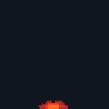

# Volcano eruption

<p align="center"></p>

A distant pixel art volcano eruption from one ChatGPT (Images 2.6) prompt, cleaned into a sprite sheet with [`scripts/clean_gif.py`](../../scripts/clean_gif.py). It is made for the background of a scene: small, with the crater at the bottom centre. The [main README](../../README.md) explains every step; this page has what is specific to the eruption.

## Files

| File | What |
|---|---|
| `eruption.gif` | the GIF as ChatGPT returned it: 309x308, 16 frames, 90 ms each, magenta background |
| `eruption_sheet.png` | the cleaned 1x sprite sheet: 16 frames of 91x91 in one row, 24 colours |
| `eruption_sheet.json` | frame rects, 90 ms per frame, `meta.anchor` (45, 90) = the crater, frame tags, the palette |
| `preview.gif` | the cleaned frames at x2 on a dark backdrop |

## The prompt

Paste it into ChatGPT as one message, in a new chat. Don't ask for the mountain: draw it in your background and put the crater at the anchor.

```text
Make an animated GIF of a pixel-art volcano eruption seen from far away, for the background of a 2D side-view game, in a square frame, rendered as large as you can. 16 frames, about 90 ms per frame. Use fine pixel art: each art pixel is exactly 2 image pixels wide. The camera does not move. The crater is at the bottom centre of the frame, at the same point in every frame; don't draw the mountain itself, only what comes out of the crater. Sequence: frames 1 to 4: the crater glows brighter and spits a few sparks; frame 5: a bright burst; frames 6 to 16: a full eruption that loops seamlessly from frame 16 back to frame 6: a fountain of glowing lava shooting straight up from the crater, glowing lava bombs flying out in high arcs and falling back down on both sides, and a thick dark ash column rising above it, its underside lit red and orange by the lava, the top of the ash staying inside the frame. Leave empty background around everything so nothing is cut off by the frame edges. True pixel art: crisp pixels on one even grid, hard edges, no anti-aliasing, no blur, no soft gradients, a limited palette of about 18 colours (white, yellows, oranges, reds, dark reds, and four dark grey-browns for the ash). Background: flat solid pure magenta #FF00FF in every frame, nothing else. No text, no borders.
```

## The cleanup command

From the repository folder, with the packages from the [Quickstart](../../README.md#quickstart) installed:

```text
python scripts/clean_gif.py effects/eruption/eruption.gif --name eruption --mode adaptive --cell 3.4 --impact 5 --scale 1 --colors 20 --neutral-greys --grey-chroma 0.05 --out-dir out
```

`out/eruption/eruption_sheet.png` is then pixel-identical to `eruption_sheet.png` in this folder, and `out/eruption/eruption_sheet.json` is identical to `eruption_sheet.json`. The summary line it prints:

```text
{"name": "eruption", "cell_px": 3.4, "grid_score": null, "native": [91, 91], "colors_after_snap": 48, "colors_final": 24, "greys_detinted": ["#f3e5dc", "#250d0d"], "biggest_frame": 11, "jitter_before": {"mean_x_step_px": 0.41, "max_x_step_px": 1.26, "max_abs_x_off_px": 2.12, "max_abs_base_off_px": 1.0}, "jitter_after": {"mean_x_step_px": 0.37, "max_x_step_px": 1.7, "max_abs_x_off_px": 2.12, "max_abs_base_off_px": 1.0}, "fringe_pixels_fixed": 127}
```

- `--cell 3.4`: 308 / 3.4 = 91 px. A bigger cell than the other effects on purpose: the volcano is far away, so the eruption is small.
- `--impact 5`: tags frame 5 as `impact`. The prompt counts frames from 1 ("frame 5: a bright burst"), the script from 0, so the white burst itself is frame 4 and frame 5 is the first frame of the full eruption. I used 5; use `--impact 4` if your scene should flash on the burst.
- `--neutral-greys --grey-chroma 0.05`: pulls the slight magenta tint out of the palette greys (2 here) and keeps the warm ash browns.
- `--colors 20`: the palette size; the script may add up to 6 accent colours (`--max-extra 6`), and this sheet ends with 24.

## Notes

- Frames 8 to 15 make the loop: going from 15 back to 8 looks like a normal frame step.
- ChatGPT did not keep the ash inside the frame: it touches the top edge from frame 7 on and the right edge from frame 8 on. In the fight at the top of the main README the volcano sits high in the background, so the cut edge is off the top of the screen.
