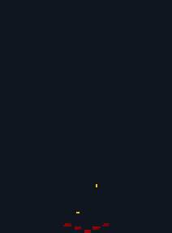

# Fire pillar

<p align="center"></p>

A pixel art fire pillar from one ChatGPT (Images 2.6) prompt, cleaned into a sprite sheet with [`scripts/clean_gif.py`](../../scripts/clean_gif.py). The [main README](../../README.md) explains every step; this page has what is specific to the fire pillar.

Video: How to Make Pixel Art Fire with ChatGPT (Step by Step) (coming soon)

## Files

| File | What |
|---|---|
| `firepillar.gif` | the GIF as ChatGPT returned it: 265x358, 16 frames, 80 ms each, magenta background |
| `firepillar_sheet.png` | the cleaned 1x sprite sheet: 16 frames of 106x143 in one row, 26 colours |
| `firepillar_sheet.json` | frame rects, 80 ms per frame, `meta.anchor` (53, 142) = the pixel where the pillar touches the ground, the palette |
| `preview.gif` | the cleaned frames at x2 on a dark backdrop |

## The prompt

Paste it into ChatGPT as one message, in a new chat. This is the re-roll: the first try asked for flames that reach the top of the frame, and they came back cut flat (that GIF is not included). Leave space above the flames, and ask for a tall frame.

```text
Make an animated GIF of a pixel-art fire pillar erupting from the ground, for a 2D side-view game, in a tall frame (taller than wide), rendered as large as you can. 16 frames, about 80 ms per frame. Use fine pixel art: each art pixel is exactly 2 image pixels wide, so the fire has a lot of detail. The camera does not move. The bottom edge of the frame is the ground line, and the pillar erupts at the bottom centre, at the same point in every frame. Don't draw the ground itself. The tallest flame tips reach about 85 percent of the frame height: always leave empty background above the fire and at both sides, so nothing is ever cut off by the frame edges. Sequence: a small glowing crack and a few embers rising; flames burst upward into a tall roaring column of fire, wider at the base, with swirling tongues of flame, a white-yellow hot core and orange, red and dark red edges; burning chunks and sparks fly out of the top; the column roars for several frames, its flames changing shape every frame; it collapses downward into low flickering flames and puffs of dark smoke; glowing embers drift up and fade until the frame is empty. True pixel art: crisp pixels on one even grid, hard edges, no anti-aliasing, no blur, no soft gradients, a limited palette of about 18 colours (white, yellows, oranges, reds, dark reds and three dark greys for the smoke). Background: flat solid pure magenta #FF00FF in every frame, nothing else. No text, no borders.
```

## The cleanup command

From the repository folder, with the packages from the [Quickstart](../../README.md#quickstart) installed:

```text
python scripts/clean_gif.py effects/fire-pillar/firepillar.gif --name firepillar --mode adaptive --cell 2.5 --scale 1 --colors 20 --neutral-greys --grey-chroma 0.05 --out-dir out
```

`out/firepillar/firepillar_sheet.png` is then pixel-identical to `firepillar_sheet.png` in this folder, and `out/firepillar/firepillar_sheet.json` is identical to `firepillar_sheet.json`. The summary line it prints:

```text
{"name": "firepillar", "cell_px": 2.5, "grid_score": null, "native": [106, 143], "colors_after_snap": 48, "colors_final": 26, "greys_detinted": ["#442f2f", "#efd3d4", "#403b3d", "#3c1f1f"], "biggest_frame": 8, "jitter_before": {"mean_x_step_px": 0.86, "max_x_step_px": 3.06, "max_abs_x_off_px": 2.86, "max_abs_base_off_px": 2.0}, "jitter_after": {"mean_x_step_px": 0.49, "max_x_step_px": 1.41, "max_abs_x_off_px": 1.8, "max_abs_base_off_px": 2.0}, "fringe_pixels_fixed": 252}
```

- `--cell 2.5`: 358 / 2.5 = 143 px tall and 265 / 2.5 = 106 px wide.
- No `--impact`: the pillar has no white flash frame, so the JSON has no frame tags.
- `--neutral-greys --grey-chroma 0.05`: pulls the slight magenta tint out of the smoke greys (4 palette greys here) and keeps the warm browns near the fire.
- `--colors 20`: the palette size; the script may add up to 6 accent colours (`--max-extra 6`), and this sheet ends with 26.

## Notes

- The re-roll worked: the highest flame pixel in the GIF is at row 14 of 358, so nothing touches the top edge.
- The light for it is the painted light from step 3 of the main README: the same lit canyon as the explosion.
