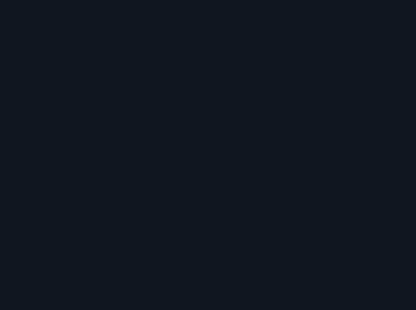

# Lightning

<p align="center"></p>

A pixel art lightning strike from one ChatGPT (Images 2.6) prompt, cleaned into a sprite sheet with [`scripts/clean_gif.py`](../../scripts/clean_gif.py). The [main README](../../README.md) explains every step; this page has what is specific to the lightning.

Video: How to Make Pixel Art Lightning with ChatGPT (Step by Step) (coming soon)

## Files

| File | What |
|---|---|
| `lightning.gif` | the GIF as ChatGPT returned it: 358x267, 14 frames, 70 ms each, green background |
| `lightning_sheet.png` | the cleaned 1x sprite sheet: 14 frames of 208x155 in one row, 22 colours |
| `lightning_sheet.json` | frame rects, 70 ms per frame, `meta.anchor` (104, 154) = the pixel where the bolt touches the ground, frame tags, the palette |
| `preview.gif` | the cleaned frames at x2 on a dark backdrop |

## The prompt

Paste it into ChatGPT as one message, in a new chat. It asks for a green background: the glow is violet, and a magenta key would cut it away.

```text
Make an animated GIF of a pixel-art lightning strike for a 2D side-view game, rendered as large as you can. 14 frames, about 70 ms per frame. Use fine pixel art: each art pixel is only 2 to 3 image pixels wide, so the bolt has a lot of detail (it spans the full frame height, about 120 art pixels). The camera does not move. The bottom edge of the frame is the ground line, and the bolt hits the ground at the bottom centre, at the same point in every frame. Don't draw the ground itself. Sequence: a thin flickering leader zigzags down from the top edge; the full bolt strikes: a thick jagged white core with an electric blue and violet glow outline and three or four forked branches; one frame where the bolt and a bright white burst at the impact point are at their brightest; the bolt flickers twice, changing its branches each time; at the impact point a burst of electric sparks flies out in arcs and short arcs of electricity crawl sideways along the ground; the bolt vanishes, leaving a glowing blue afterimage that fades; a few sparks and a small curl of dark smoke fade out until the frame is empty. True pixel art: crisp pixels on one even grid, hard edges, no anti-aliasing, no blur, no soft gradients, a limited palette of about 16 colours (white, pale cyan, electric blues, violets, two dark greys for the smoke). Background: flat solid pure green #00FF00 in every frame, nothing else. No text, no borders.
```

## The cleanup command

From the repository folder, with the packages from the [Quickstart](../../README.md#quickstart) installed:

```text
python scripts/clean_gif.py effects/lightning/lightning.gif --name lightning --key green --mode adaptive --cell 1.72 --impact 6 --scale 1 --colors 16 --out-dir out
```

`out/lightning/lightning_sheet.png` is then pixel-identical to `lightning_sheet.png` in this folder, and `out/lightning/lightning_sheet.json` is identical to `lightning_sheet.json`. The summary line it prints:

```text
{"name": "lightning", "cell_px": 1.72, "grid_score": null, "native": [208, 155], "colors_after_snap": 48, "colors_final": 22, "greys_detinted": [], "biggest_frame": 6, "jitter_before": {"mean_x_step_px": 0.93, "max_x_step_px": 4.28, "max_abs_x_off_px": 2.37, "max_abs_base_off_px": 114.0}, "jitter_after": {"mean_x_step_px": 0.48, "max_x_step_px": 1.77, "max_abs_x_off_px": 3.16, "max_abs_base_off_px": 114.0}, "fringe_pixels_fixed": 159}
```

- `--key green`: the GIF's background is green, so the violet glow survives the key.
- `--cell 1.72`: 267 / 1.72 = 155 px tall and 358 / 1.72 = 208 px wide. That is close to the lower limit: below about 1.7 the downscale stops working.
- `--impact 6`: frame 6 (counting from 0) is the strike with the bright white burst at the impact point; it is also the biggest frame.
- `--colors 16`: the palette size; the script may add up to 6 accent colours (`--max-extra 6`), and this sheet ends with 22.

## Notes

- ChatGPT's real grid here is about 4 image pixels, not the 2 to 3 the prompt asked for.
- The flash frame is also the biggest frame, so the JSON's `fireball` tag is empty (from 7 to 6). The other tags: `anticipation` 0 to 5, `impact` 6, `smoke` 7 to 13.
- In the fight at the top of the main README the bolt also gets a hit-stop, 2 impact frames and a coded colour light. Those are part of the fight scene, which is not in this repository.
